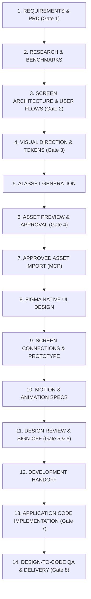

# The Canonical Production Pipeline & Design Workflow

This document details the production lifecycle executed by you and the AI UI/UX Design Agent in this workspace. It adheres strictly to the **14-Stage Production Pipeline** and the **8 Mandatory Approval Gates** documented in [`docs/APPROVAL_WORKFLOW.md`](./docs/APPROVAL_WORKFLOW.md).

---

## The Canonical 14-Stage Pipeline

---

## Detailed Stage Breakdown & Quality Rules

### Stage 01: Requirements & PRD (Gate 1)
- Deeply clarify business objectives, user goals, and technical constraints.
- Document functional user stories, data inputs/outputs, and edge cases in `requirements/PRD.md` and `requirements/FEATURE_INVENTORY.md`.

### Stage 02: Research & Benchmarks
- Benchmark real-world design leaders (Apple, Airbnb, Revolut, Linear).
- Evaluate platform-specific guidelines: Apple Human Interface Guidelines (HIG) and Google Material Design 3.

### Stage 03: Screen Architecture & User Flows (Gate 2)
- **Mandatory Pre-Design Step**: Never place frames on canvas before architecture is approved.
- Generate complete screen inventory with standardized IDs (`AUTH-01`, `HOME-01`, `WALLET-01`).
- Construct user-flow diagrams (Mermaid), screen connection matrices, and state inventories (Idle, Loading, Error, Empty).

### Stage 04: Visual Direction & Tokens (Gate 3)
- Define bespoke visual identity based on project research (never hardcode generic defaults).
- Establish semantic color variables, typography ramp, 8pt spatial scale, and elevation styles in `design-system/TOKENS.json`.

### Stage 05: AI Asset Generation
- Generate custom illustrations, 3D elements, hero graphics, and backgrounds using free cloud engines (Antigravity Imagen 3).
- Track explicit commercial licensing metadata (Provider, Model, Terms URL, License Status).

### Stage 06: Asset Preview & Approval (Gate 4)
- Present candidate preview carousels in chat/artifacts with technical specifications.
- **Mandatory Gate**: Wait for explicit user approval before importing into Figma.

### Stage 07: Approved Asset Import (MCP)
- Optimize approved assets (SVGO / Sharp) and upload directly to Figma using MCP `upload_assets` ($0 AI credit cost).
- Log placed node IDs in `assets/manifest/asset-manifest.md`.

### Stage 08: Figma Native UI Design
- Construct screens using native semantic frames (`SCREEN`, `CARD`, `ROW`), native Auto Layout (`HUG`/`FILL`), variables, and components.
- Never substitute static screenshots or flattened SVGs for editable design layers.

### Stage 09: Screen Connections & Prototype
- Wire realistic click-through interactions, triggers (`On Tap`, `On Drag`), and Smart Animate transitions across the canvas.
- Eliminate dead ends: every interactive element must have defined navigation or feedback.

### Stage 10: Motion & Animation Specifications
- Document triggers, initial/final states, durations, easing curves, Spring physics, and accessible reduced-motion fallbacks in `motion/MOTION_SPECIFICATIONS.md`.

### Stage 11: Design Review & Sign-Off (Gate 5 & 6)
- Perform comprehensive design audit: layout completeness, touch ergonomics (≥ 44×44 pt), WCAG AA color contrast (≥ 4.5:1), and edge states.
- Present completed Figma file to user for final design sign-off.

### Stage 12: Development Handoff
- Export structured tokens JSON, component property tables, and spacing documentation in `handoff/SPECIFICATIONS.md`.

### Stage 13: Application Code Implementation (Gate 7)
- Translate approved Figma designs into target framework (SwiftUI, Jetpack Compose, React Native, or Web).
- Keep production source code in authorized project repositories.

### Stage 14: Design-to-Code QA & Delivery (Gate 8)
- Execute Playwright and axe-core visual regression to compare rendered code against Figma reference frames.
- Deliver verified code, updated manifests, and git-synchronized repository.

---

## Natural Language Commands & Workflow Mapping

As a Figma beginner, you interact with Antigravity using simple natural language commands. Each maps directly to verified automated workflows and CLI scripts:

| Natural Language Command | Workflow Stages Triggered | Operational Execution | Artifacts & Output |
|---|---|---|---|
| **`"Start a new project <name>"`** | Stage 01 (Gate 1) | Runs `./scripts/new-project <name>`, initializes isolated directory, sets up `project.config.json` | `projects/<name>/` scaffolding |
| **`"Continue project <name>"`** | Current Active Stage | Reads `projects/<name>/project.config.json`, restores Figma file link & active approval gate | Project status report & next gate |
| **`"Research this project"`** | Stage 02 | Analyzes market leaders (Apple, Revolut, Linear), maps personas, audits Apple HIG / Material 3 | `research/COMPETITIVE_RESEARCH.md`, `USER_PERSONAS.md` |
| **`"Create the screen architecture"`** | Stage 03 (Gate 2) | Builds standardized screen IDs (`ONB-01`, `HOME-01`), user flows, runs `./scripts/audit-architecture <name>` | `architecture/SCREEN_INVENTORY.md`, `USER_FLOWS.md` |
| **`"Generate design concepts"`** | Stage 04 (Gate 3) | Establishes custom palette, typography scale, 8pt grid tokens, and visual identity (no generic templates) | `design-system/TOKENS.json` |
| **`"Show me asset previews"`** | Stage 05 & 06 (Gate 4) | Generates candidate variants via free cloud AI (Imagen 3); creates visual preview artifact for user sign-off | `assets/generated/`, preview artifact in chat |
| **`"Create the approved Figma design"`** | Stage 07 & 08 (Gate 5) | Optimizes approved assets, uploads to canvas via MCP `upload_assets` ($0 cost), constructs native vector/frame hierarchy | Live editable frames in target Figma file |
| **`"Connect the prototype"`** | Stage 09 & 10 (Gate 6) | Documents interactive triggers, transitions, Spring physics; renders Mermaid user flows to FigJam via `generate_diagram` | `motion/MOTION_SPECIFICATIONS.md`, FigJam diagram |
| **`"Run design QA"`** | Stage 11 & 14 (Gate 8) | Executes Playwright + axe-core WCAG AA contrast check and 44×44 pt touch target audit | `qa/reports/`, JSON audit report |
| **`"Prepare design handoff"`** | Stage 12 (Gate 7) | Generates component property tables, export assets, and design token handoff specs | `templates/development-handoff/HANDOFF_TEMPLATE.md` |

