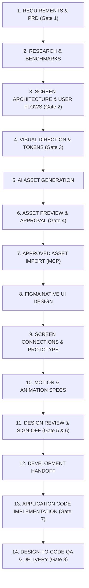

# 🎨 Smart AI Figma Helper & Multi-Project Design Workspace

[](https://mcp.figma.com/mcp)
[](#-strict-git-policy--single-main-branch-only)
[](https://playwright.dev/)
[](https://nodejs.org/)
[](https://opensource.org/licenses/ISC)

A reusable, AI-powered UI/UX Design-to-Code Workspace and Bridge designed for **Google Antigravity**, **Figma Remote MCP**, and automated **QA Design Verification**.

---

## 🎯 Workspace Objective: Smart AI Figma Helper & Bridge

This repository is **NOT** a customer-facing software application. It is your personal **Smart AI Figma Helper & Bridge**.

- **Designed for Figma Beginners with QA Background**: You do not need to manually draw frames, fiddle with Auto Layout, build components, connect prototypes, or organize pages. Antigravity executes these operations autonomously through verified MCP tools and scripts.
- **Your Role as Product Owner**: You provide project requirements, review previews in chat/artifacts, and approve critical decisions at the 8 mandatory approval gates.
- **Multi-Project Isolation**: A single repository capable of managing multiple independent mobile and web projects (`projects/<projectName>/`) without data cross-contamination or tool reinstallations.
- **$0 Budget Policy**: Zero paid API subscriptions, zero free trial sign-ups, and zero consumption of paid Figma AI credits (`generate_image` is strictly prohibited). All assets are generated via Antigravity's free cloud subagent and imported directly into Figma via MCP `upload_assets`.

---

## 🔒 Strict Git Policy — SINGLE MAIN BRANCH ONLY

This workspace operates strictly on a **single branch**:

- **Use ONLY `main`**: All work, configurations, documentation, and assets are committed directly to `main`.
- **Zero Extra Branches**: Never create feature branches (`feat/*`), development branches (`dev`), fix branches, or PR branches.
- **No Branch Switching**: Work trees remain clean and stable without Git-flow complexity.
- **Preserve All Work**: Always verify `git status` before committing. Never force-push or overwrite uncommitted changes.

---

## 🏗️ Repository Architecture

```text
Figma/
├── README.md                      # Complete workspace documentation & guide
├── AGENTS.md                      # AI agent operating instructions & production rules
├── FIGMA_AGENT_RULES.md           # Figma Auto Layout, component, token & git constraints
├── FIGMA_LEARNING_GUIDE.md        # Educational curriculum: QA to Product Design mastery
├── FIGMA_QA_CHECKLIST.md          # 8pt grid, WCAG AA, and touch target checklist
├── FIGMA_TOOLKIT.md               # Quick-reference locator for Figma features
├── FIGMA_WORKFLOW.md              # The canonical 14-stage production methodology
├── package.json                   # QA & optimization scripts + dependencies
├── pnpm-lock.yaml                 # Lockfile for reproducible builds
│
├── docs/                          # Core system architecture & audits
│   ├── APPROVAL_WORKFLOW.md       # The 8 mandatory approval gates specification
│   ├── TOOL_VERIFICATION.md       # Verified tool execution & environment audit
│   ├── WORKSPACE_ARCHITECTURE.md  # Multi-project directory isolation rules
│   └── WORKSPACE_AUDIT.md         # Comprehensive health audit log
│
├── .agents/skills/                # Specialized design, QA & platform skills
│   ├── figma-design-agent/        # Master coordinator skill
│   ├── figma-auto-layout/         # Auto Layout flexbox mastery
│   ├── figma-components/          # Variant sets and component properties
│   ├── figma-design-systems/      # Variables, tokens, and color themes
│   ├── figma-accessibility/       # WCAG 2.1 AA audit protocols
│   ├── mobile-ui-design/          # Safe areas, thumb zones, viewports
│   ├── visual-regression/         # Playwright screenshot comparison
│   └── design-to-code/            # SwiftUI / Jetpack Compose translation
│
├── tools/                         # Reusable production utilities
│   ├── asset-generation/          # Free AI image generation helpers (strict licensing)
│   ├── asset-optimization/        # SVGO + Sharp @1x/@2x/@3x raster scaler
│   ├── figma-integration/         # Figma MCP URL parser & token sync
│   ├── design-validation/         # Playwright + axe-core QA runner & architecture audit
│   └── visual-regression/         # Screenshot diffing harness
│
├── templates/                     # Golden scaffolding templates
│   ├── mobile-app/                # iOS & Android semantic frame hierarchy
│   ├── web-app/                   # Responsive 12-column grid breakpoints
│   ├── design-system/             # Design token JSON schema
│   ├── asset-library/             # Manifest & category structure
│   ├── project-documentation/     # PRD & UX benchmark templates
│   └── development-handoff/       # Developer specs & tokens handoff
│
├── projects/                      # Independent project workspaces
│   ├── PROJECT_TEMPLATE/          # Complete golden template for new projects
│   └── fintech-mobile-app/        # Project workspace (On Hold - Pending Authorization)
│
└── scripts/                       # Automation CLI tools (Executable entrypoints)
    ├── new-project                # Scaffolds an isolated project from template
    ├── validate-project           # Verifies project JSON config & directories
    ├── validate-assets            # Audits asset sizes and manifest records
    ├── audit-architecture         # Validates screen architecture, flows & states
    └── generate-project-report    # Prints project status & pipeline gates
```

---

## ⚡ The Canonical 14-Stage Pipeline & 8 Approval Gates

Every project strictly follows this 14-stage sequence:



### The 8 Mandatory Approval Gates
1. **Gate 1: Requirements Sign-Off**: PRD, user stories, edge cases, target platform.
2. **Gate 2: Screen Architecture Sign-Off**: Screen inventory (`[MODULE]-[INDEX]`), user journeys, navigation matrix.
3. **Gate 3: Visual Direction Sign-Off**: Moodboard, typography scale, semantic tokens, 8pt spatial grid.
4. **Gate 4: Asset Approval**: Visual asset candidate variants reviewed in chat/artifacts before Figma import.
5. **Gate 5: Figma UI Design Sign-Off**: Review live editable screens on the canvas.
6. **Gate 6: Prototype & Motion Sign-Off**: Review interaction connections, triggers, easing curves.
7. **Gate 7: Development Handoff**: Token specs, component documentation, layout parameters.
8. **Gate 8: Design-to-Code QA & Delivery**: Visual diff tolerance < 2%, WCAG 2.1 AA pass, touch ergonomics.

---

## 🚀 Quickstart Guide

### 1. Prerequisites
- **Node.js**: `v20+` or `v26+` (`node -v`)
- **Package Manager**: `pnpm` or `npm`
- **Figma Account**: Connected via Antigravity Figma Remote MCP (`https://mcp.figma.com/mcp`)
- **Git**: Configured on `main` branch (`git status`)

### 2. Installation
```bash
git clone https://github.com/rik9922/Figma.git
cd Figma
pnpm install
```

### 3. Create a New Project
Run the new-project script:
```bash
./scripts/new-project <project-name> [platform] [framework]

# Examples:
./scripts/new-project crypto-wallet iOS SwiftUI
./scripts/new-project ride-sharing Android "React Native"
./scripts/new-project saas-companion Web React
```

### 4. Working with Antigravity
In the Antigravity chat, interact naturally with the agent:
- **To start a new project**: `"Start a new project named e-commerce-app"`
- **To continue an existing project**: `"Continue project <name>"`
- **To authorize design**: Give an explicit prompt such as `"Start designing the <name> project"` (design work is never started autonomously without explicit instruction)
- **To audit architecture**: Run `./scripts/audit-architecture <name>`
- **To audit design tokens contrast**: Run `node tools/design-validation/audit-tokens-contrast.js <name>`
- **To view status**: Run `./scripts/generate-project-report <name>`

---

## 🛠️ CLI Commands & Tooling

| Command | Description |
|---|---|
| `./scripts/new-project <name> [platform] [framework]` | Scaffolds a complete isolated project from `PROJECT_TEMPLATE` |
| `./scripts/validate-project <name>` | Validates project structure, essential directories & `project.config.json` |
| `./scripts/validate-assets <name>` | Verifies asset formats, file sizes (< 10MB), and manifest records |
| `./scripts/audit-architecture <name>` | Verifies screen IDs, navigation matrix, flows, and edge states |
| `./scripts/generate-project-report <name>` | Outputs project metadata, Figma references, and status of all 8 gates |
| `pnpm run qa <file.html> [ios\|android]` | Runs Playwright accessibility (axe-core) and touch target audit |
| `pnpm run optimize <svg\|raster\|scales> <file>` | Runs SVGO optimization or Sharp mobile `@1x/@2x/@3x` generation |

---

## 🔒 Security & Portability Principles
- **Main Branch Exclusively**: Never create separate git branches; keep history linear and clean.
- **Zero Credentials in Git**: All tokens, OAuth secrets, and personal access tokens are strictly ignored in `.gitignore`.
- **Zero Paid AI Credits**: Images are generated using free cloud engines in Antigravity, and uploaded to Figma via the free `upload_assets` MCP tool without burning paid Figma AI credits.
- **Project Isolation**: Assets, branding, and Figma file keys are never shared between projects unless explicitly authorized.

---

## 📄 License
This project is licensed under the ISC License.
