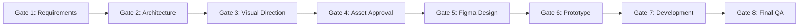

# Canonical Approval Workflow & Gate Definitions

## The 8 Mandatory Approval Gates

To maintain strict human oversight and prevent autonomous deviation, every project proceeds through 8 sequential gates. **Antigravity may research, draft, generate alternatives, and run non-destructive audits autonomously, but crossing an approval gate requires explicit user sign-off.**

---

### Gate 1: Requirements Approval
- **Deliverables Reviewed**: `requirements/PRD.md`, `requirements/FEATURE_INVENTORY.md`.
- **Review Criteria**: Core problem, user roles, functional user stories, edge cases, technical constraints.
- **Required Action**: User reviews requirements and grants explicit approval.
- **State Transition**: `workflowStatus.requirementsApproved: true` in `project.config.json`.

---

### Gate 2: Architecture Approval
- **Deliverables Reviewed**: `architecture/SCREEN_INVENTORY.md`, `architecture/USER_FLOWS.md`, `architecture/NAVIGATION_ARCHITECTURE.md`, `architecture/SCREEN_CONNECTION_MATRIX.md`.
- **Review Criteria**: Complete screen inventory with unique IDs, user journeys without dead-ends, documented back navigation, full state coverage (Idle, Loading, Error, Empty).
- **Required Action**: User audits navigation flow and approves screen architecture before canvas drawing begins.
- **State Transition**: `workflowStatus.architectureApproved: true`.

---

### Gate 3: Visual Direction Approval
- **Deliverables Reviewed**: `design-system/TOKENS.json`, `research/DESIGN_REFERENCES.md`, visual moodboard, color palette.
- **Review Criteria**: Brand voice, distinct color system, typography ramp, 8pt spatial grid, depth/elevation.
- **Required Action**: User selects or approves preferred aesthetic direction.
- **State Transition**: `workflowStatus.visualDirectionApproved: true`.

---

### Gate 4: Asset Approval
- **Deliverables Reviewed**: Preview carousel in chat/artifact, `assets/manifest/asset-manifest.md`.
- **Review Criteria**: High-resolution image quality, clean studio background, zero unwanted text artifacts, honest commercial licensing status (`VERIFIED_COMMERCIAL_USE`).
- **Required Action**: User explicitly approves candidate variants for import into Figma.
- **State Transition**: `workflowStatus.assetsApproved: true`.

---

### Gate 5: Figma Design Approval
- **Deliverables Reviewed**: Native editable Figma canvas in target file.
- **Review Criteria**: Strict Auto Layout (`HUG`/`FILL`), semantic frame hierarchy (`SCREEN`, `CARD`, `ROW`), bound variables, WCAG AA contrast (≥ 4.5:1), touch targets (≥ 44×44 pt).
- **Required Action**: User inspects editable frames in Figma and grants design sign-off.
- **State Transition**: `workflowStatus.figmaDesignApproved: true`.

---

### Gate 6: Prototype Approval
- **Deliverables Reviewed**: Connected click-through prototype in Figma.
- **Review Criteria**: Meaningful triggers (On Tap, On Drag), Smart Animate transitions, realistic spring physics, documented reduced-motion fallbacks.
- **Required Action**: User tests prototype click-through and confirms flow completeness.
- **State Transition**: `workflowStatus.prototypeApproved: true`.

---

### Gate 7: Development Handoff Approval
- **Deliverables Reviewed**: `handoff/SPECIFICATIONS.md`, design token exports, asset slices.
- **Review Criteria**: Implementation architecture established, external repository linked (if applicable), framework compatibility verified.
- **Required Action**: User authorizes transition from design to code implementation.
- **State Transition**: `workflowStatus.codeImplementationApproved: true`.

---

### Gate 8: Final QA & Delivery Approval
- **Deliverables Reviewed**: `qa/REPORTS.md`, Playwright screenshot comparisons, accessibility report.
- **Review Criteria**: Zero critical WCAG violations, visual diff tolerance < 2%, git commit history clean.
- **Required Action**: Final delivery sign-off.
- **State Transition**: `workflowStatus.qaPassed: true`.
