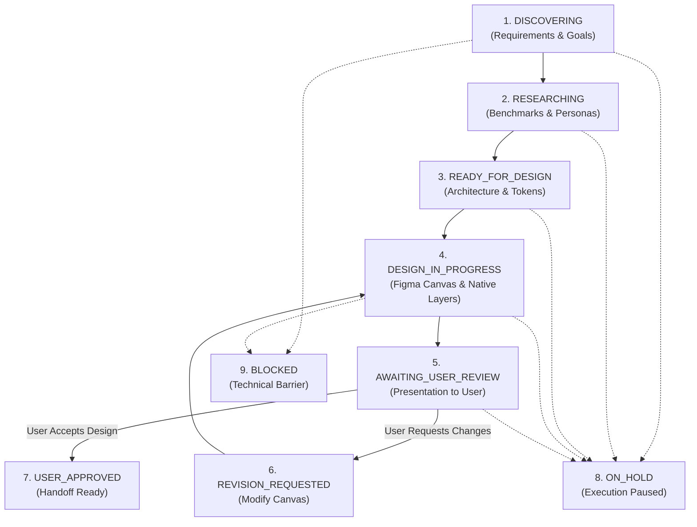

# User Review & Approval Workflow Specification

## 1. Core Principle: Human Approval Sole Authority

In this workspace, the human user is the **sole design reviewer and approval authority**.

- The AI agent creates, researches, architects, and implements editable Figma designs.
- Automated technical scripts validate syntax, formats, file sizes, and token contrast ratios.
- **Automated scripts never approve designs.** The agent cannot approve its own work.
- Explicit user sign-off in chat is mandatory to mark any design work as approved.

---

## 2. The 9 Authoritative Project Lifecycle States

### State Definitions & Rules

| State                      | Purpose                                                            | Transition Requirement                                         |
| -------------------------- | ------------------------------------------------------------------ | -------------------------------------------------------------- |
| **`DISCOVERING`**          | Requirements clarification, scope definition.                      | Automatic on project initialization.                           |
| **`RESEARCHING`**          | Benchmarking competitors, mapping user personas.                   | Requirements drafted in `requirements/PRD.md`.                 |
| **`READY_FOR_DESIGN`**     | Complete screen inventory, flows, and design tokens established.   | Technical validation passes (`audit-architecture`).            |
| **`DESIGN_IN_PROGRESS`**   | Building native Figma frames, Auto Layout, components, tokens.     | User gives explicit design direction.                          |
| **`AWAITING_USER_REVIEW`** | Complete frames presented with links, screenshots, and rationales. | Agent completes requested creation scope.                      |
| **`REVISION_REQUESTED`**   | User provides specific feedback, critique, or change requests.     | User indicates adjustments needed in chat.                     |
| **`USER_APPROVED`**        | Explicit human sign-off granted.                                   | User writes explicit approval (e.g. "Approved", "Looks good"). |
| **`ON_HOLD`**              | Execution paused. No canvas or asset operations permitted.         | User requests pause, or project unselected (e.g. fintech).     |
| **`BLOCKED`**              | Halted due to external access, token issue, or dependency.         | Unresolved blocker detected.                                   |

---

## 3. The Design Review Process (Human in the Loop)

When design creation for a requested scope is completed, the agent must:

1. **Present the Work Transparently**:
   - Provide direct link to the Figma file and relevant page.
   - List created/updated frame names and canvas coordinates.
   - Present screenshots of key screens for convenient chat preview.
2. **Explain Key Design Decisions**:
   - Visual hierarchy, typography ramp, and color relationships.
   - Auto Layout structure, component variants, and variable bindings.
   - State coverage (Default, Active, Error, Empty, Loading).
3. **Report Honestly**:
   - Highlight any known limitations, platform edge cases, or pending dependencies.
   - Never claim an unexecuted action was completed.
4. **Transition to `AWAITING_USER_REVIEW`**:
   - Update `project.config.json` lifecycle state.
   - Log entry in `revisions/REVISION_HISTORY.md`.
   - **Pause and wait for user response.**

---

## 4. Handling User Feedback (Revision Flow)

When the user requests changes:

1. Acknowledge and summarize feedback points.
2. Transition state to `REVISION_REQUESTED`.
3. Modify the actual Figma frames and components on canvas.
4. Preserve existing approved work that is unrelated to the requested change.
5. Log changes in `revisions/REVISION_HISTORY.md`.
6. Present updated screenshots and diff summary, returning to `AWAITING_USER_REVIEW`.

Only when the user explicitly accepts the design does the state transition to `USER_APPROVED`.
