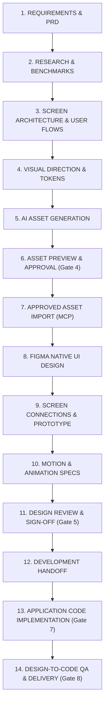

# Workspace Architecture & Multi-Project Specification

## 1. System Philosophy

The Figma Design-to-Code Workspace (`https://github.com/rik9922/Figma`) is an autonomous engineering environment designed for **Google Antigravity**, **Figma Remote MCP**, and automated **Playwright QA**.

### Core Architecture Axioms:
1. **Zero Contamination**: Reusable tools, templates, and agent instructions reside at the root; all project data resides under `projects/<projectName>/`.
2. **Deterministic Tooling**: Tools are written in pure Node.js (ESM) with zero heavy framework requirements, running on macOS (MacBook Air M5).
3. **Approval Gating**: Design, visual identity, asset import, and development transitions require explicit human sign-off.
4. **$0 Budget Enforcement**: Never consume paid Figma AI credits or third-party paid APIs. Use Antigravity's free AI generation and Figma MCP's free `upload_assets`.

---

## 2. Directory Layout & Roles

```text
Figma/
├── .agents/skills/                 # 14 Reusable design & QA capability definitions
├── docs/                           # System audits, architecture, and tool verification
├── tools/                          # Project-agnostic CLI utilities & node modules
│   ├── asset-generation/           # Brief formulation & licensing tracking
│   ├── asset-optimization/         # SVGO & Sharp @1x/@2x/@3x scaler
│   ├── figma-integration/          # Figma MCP URL parsing & payload formatting
│   ├── design-validation/          # Playwright + axe-core QA runner & architecture auditor
│   └── visual-regression/          # Screenshot diffing harness
├── templates/                      # Scaffolding blueprints for new projects
│   ├── mobile-app/                 # Mobile container hierarchies & safe areas
│   ├── web-app/                    # Responsive grid standards
│   ├── design-system/              # Design tokens schema (W3C standard)
│   ├── asset-library/              # Asset manifest & tracking templates
│   ├── project-documentation/      # PRD, Benchmarks, & Screen Architecture templates
│   └── development-handoff/        # Handoff spec templates
├── projects/                       # Isolated project workspaces
│   ├── PROJECT_TEMPLATE/           # Golden blueprint cloned by ./scripts/new-project
│   └── fintech-mobile-app/         # Active iOS digital banking application
└── scripts/                        # Root CLI commands
    ├── new-project                 # Project scaffolding CLI
    ├── validate-project            # Structure & config validator
    ├── validate-assets             # Asset size & manifest auditor
    ├── audit-architecture          # Screen inventory & navigation validator
    └── generate-project-report     # Pipeline gate status summary
```

---

## 3. The Canonical 14-Stage Production Pipeline



---

## 4. Multi-Project Isolation Contract

Each project in `projects/<name>/` is completely self-contained:
- **`project.config.json`**: Holds target platform, language, framework, brand personality, and dedicated Figma file URL/key.
- **`requirements/`**: Project-specific PRD and user stories.
- **`research/`**: Benchmark analysis against real-world apps.
- **`architecture/`**: Screen inventory, Mermaid flow diagrams, connection matrix.
- **`assets/`**: Distinct `generated/`, `approved/`, `rejected/`, and `manifest/` directories.
- **`design-system/`**: Dedicated `TOKENS.json` with semantic variable bindings.
- **`qa/`**: Project-scoped accessibility and touch-target reports.

A project **NEVER** inherits or leaks assets, colors, or Figma node IDs from another project.

