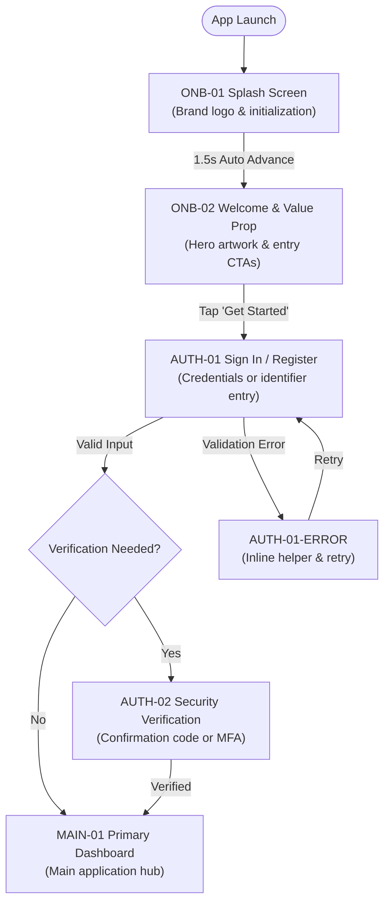
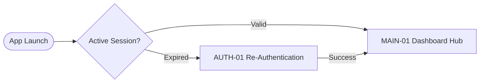
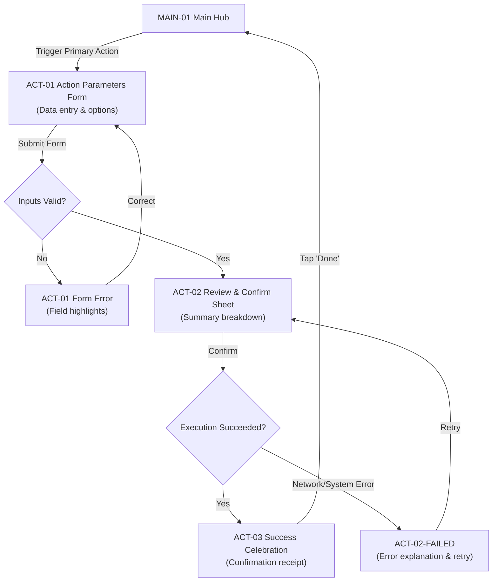
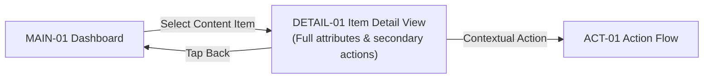

# User Flow Diagrams: {{PROJECT_NAME}}

## 1. First-Time User Onboarding & Authentication Journey

---

## 2. Returning User Experience Flow

---

## 3. Core Task Execution Journey

---

## 4. Item Detail & Content Exploration Flow

