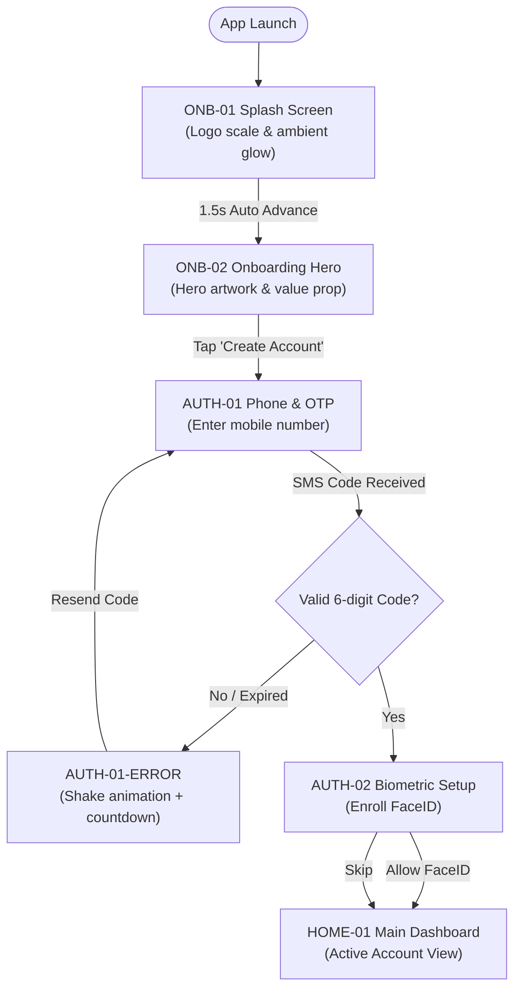
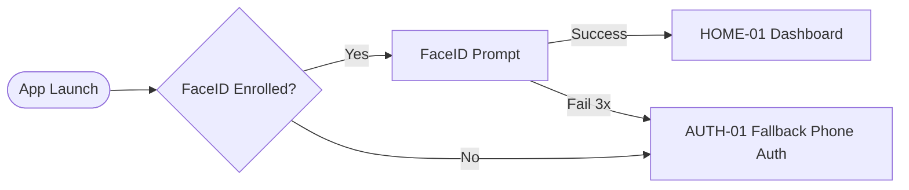
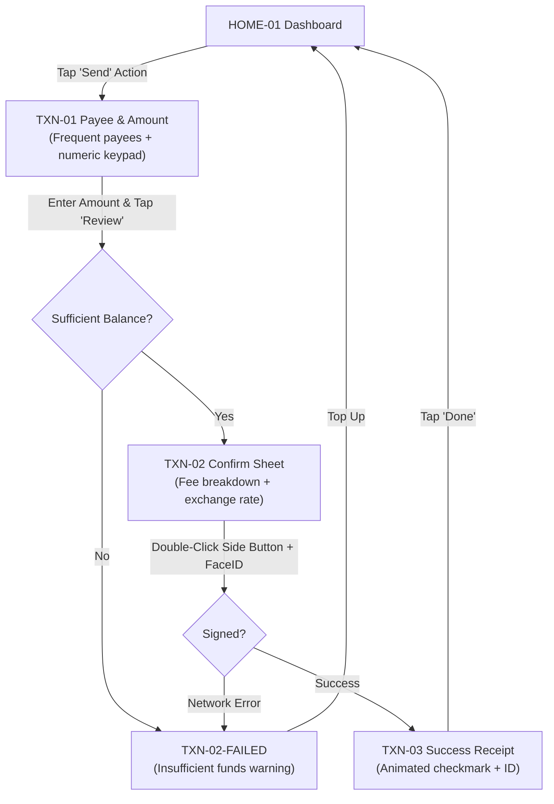
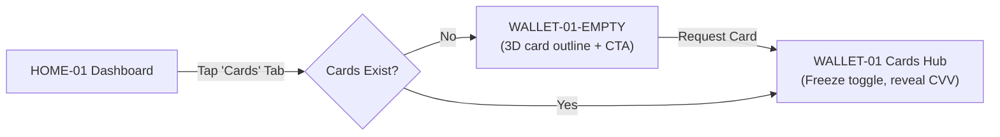

# Complete User Flow Diagrams: {{PROJECT_NAME}}

## 1. First-Time User Onboarding & Registration Journey

---

## 2. Returning User & Quick Biometric Auth Flow

---

## 3. Peer-to-Peer Transfer & Payment Flow

---

## 4. Digital Cards Management & Edge States

