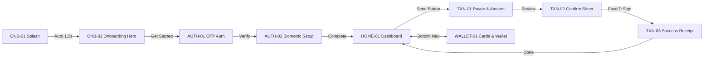

# Screen Architecture & Navigation Specification: {{PROJECT_NAME}}

## 1. Screen Inventory & Hierarchy

| Screen ID | Screen Name | Module / Flow | Viewport | Primary Purpose | Entry Point | Primary Action |
|---|---|---|---|---|---|---|
| `ONB-01` | Splash / Brand Reveal | Onboarding | 393×852 | Initial brand presentation & app loading | App Launch | Auto-advance (1.5s) |
| `ONB-02` | Value Prop & Hero | Onboarding | 393×852 | Introduce core benefits with hero visual | `ONB-01` | Tap "Get Started" |
| `AUTH-01` | Phone & OTP Auth | Authentication | 393×852 | Secure mobile number & 6-digit code entry | `ONB-02` | Submit OTP |
| `AUTH-02` | Biometric Security | Authentication | 393×852 | Enable FaceID / TouchID / Passcode | `AUTH-01` | Enable Biometrics |
| `HOME-01` | Main Dashboard | Core Product | 393×852 | Account balances, quick actions, activity | `AUTH-02` | Select action/card |
| `WALLET-01`| Digital Cards | Cards & Assets | 393×852 | Virtual card details, freeze/unfreeze controls | `HOME-01` Nav Tab | Tap Card |
| `TXN-01` | Quick Send / Payee | Payments | 393×852 | Recipient selection & amount entry | `HOME-01` "Send" | Tap "Review" |
| `TXN-02` | Transaction Confirm | Payments | 393×852 | Fee breakdown, exchange rate & biometric sign | `TXN-01` | Authenticate |
| `TXN-03` | Success Receipt | Payments | 393×852 | Confirmed transfer receipt & micro-celebration | `TXN-02` | Tap "Done" (→ `HOME-01`)|

---

## 2. Edge States & Secondary Views

| State ID | Parent Screen | State Type | Purpose & Handling |
|---|---|---|---|
| `HOME-01-LOADING` | `HOME-01` | Loading | Shimmer skeleton loader across balance cards and list |
| `WALLET-01-EMPTY` | `WALLET-01` | Empty State | "No active cards yet" with custom illustration & "Add Card" CTA |
| `AUTH-01-ERROR` | `AUTH-01` | Error State | Invalid OTP badge, countdown timer, and "Resend Code" link |
| `TXN-02-FAILED` | `TXN-02` | Failure State | Insufficient balance / Network timeout overlay with retry button |

---

## 3. Navigation & Screen Connection Matrix

---

## 4. Motion & Animation Specifications

| Animation ID | Source Screen | Destination | Trigger | Duration | Easing Curve | Motion Behavior | Reduced-Motion Fallback |
|---|---|---|---|---|---|---|---|
| `MOT-01` | `ONB-01` | `ONB-02` | Delay (1500ms) | 450ms | `cubic-bezier(0.16, 1, 0.3, 1)` | Hero graphic scales 0.95 → 1.0; text fades in +8px Y | Simple opacity fade 200ms |
| `MOT-02` | `ONB-02` | `AUTH-01` | On Tap "Get Started" | 350ms | `ease-out` (Smart Animate) | Push Left; action button morphs into input field | Cross-fade 200ms |
| `MOT-03` | `HOME-01` | `TXN-01` | On Tap "Send" | 300ms | Spring `(mass: 1, stiffness: 200, damping: 25)` | Bottom sheet slides up with background dimming 40% | Instant sheet appearance |
| `MOT-04` | `TXN-02` | `TXN-03` | Biometric Confirm | 500ms | `cubic-bezier(0.34, 1.56, 0.64, 1)` | Success checkmark draws; subtle haptic confetti burst | Static checkmark + fade |

---

## 5. Proposed Figma Canvas Layout (8-Page Architecture)

1. `00 Cover & Project Overview`: Project title, device targets, design system specs.
2. `01 Visual Research & References`: Benchmarks (Apple, Revolut, Linear), moodboard, color palette.
3. `02 User Flows & Navigation Architecture`: Mermaid diagrams, connection map, screen inventory.
4. `03 Design Exploration`: Typography tests, alternative card treatments, exploratory iterations.
5. `04 Approved UI Screens`: Production frames arranged left-to-right (`ONB` → `AUTH` → `CORE` → `TXN`).
6. `05 Components & Design System`: Master buttons, inputs, cards, list items with variant sets.
7. `06 Prototype & Interaction Studies`: Clickable prototype connections, Smart Animate flows.
8. `07 Ready for Development`: Dev Mode redlines, tokens JSON, asset export specifications.
