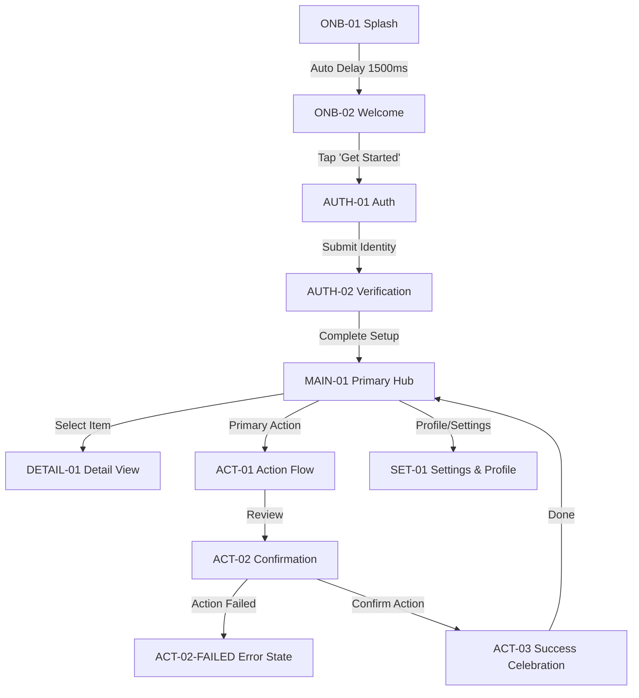

# Screen Architecture & Navigation Specification: {{PROJECT_NAME}}

## 1. Executive Summary & Product Objective

Define the project objective, target audience, primary user outcomes, and target viewport (iOS / Android / Web) during Stage 01 Requirements.

---

## 2. Complete Screen & State Inventory

| Screen ID   | Screen Name            | Module / Flow   | Viewport          | Primary Purpose                                      | Entry Point | Primary Action            |
| ----------- | ---------------------- | --------------- | ----------------- | ---------------------------------------------------- | ----------- | ------------------------- |
| `ONB-01`    | Splash Screen          | Onboarding      | Standard Viewport | Ambient brand reveal & application initialization    | App Launch  | Auto-advance (1.5s delay) |
| `ONB-02`    | Value Prop & Welcome   | Onboarding      | Standard Viewport | Introduce core value proposition and entry CTAs      | `ONB-01`    | Tap "Get Started"         |
| `AUTH-01`   | Sign In / Registration | Authentication  | Standard Viewport | User identity entry with active focus state          | `ONB-02`    | Tap "Continue"            |
| `AUTH-02`   | Verification / MFA     | Authentication  | Standard Viewport | Verification code entry or multi-factor confirmation | `AUTH-01`   | Submit verification       |
| `MAIN-01`   | Primary Dashboard      | Core Experience | Standard Viewport | Primary hub, overview cards, and activity stream     | `AUTH-02`   | Select primary action     |
| `DETAIL-01` | Item / Content Detail  | Core Experience | Standard Viewport | Comprehensive item inspection and secondary actions  | `MAIN-01`   | Tap item card             |
| `ACT-01`    | Primary Action Flow    | Key Action      | Standard Viewport | Input parameters, form fields, and validation        | `MAIN-01`   | Tap "Review"              |
| `ACT-02`    | Confirmation Review    | Key Action      | Standard Viewport | Summary breakdown, fee/detail confirmation           | `ACT-01`    | Confirm action            |
| `ACT-03`    | Success Celebration    | Key Action      | Standard Viewport | Confirmation state, receipt details, and exit CTA    | `ACT-02`    | Tap "Done" (→ `MAIN-01`)  |
| `SET-01`    | Settings & Profile     | Account         | Standard Viewport | User profile, preferences, and security switches     | `MAIN-01`   | Modify settings           |

---

## 3. Comprehensive State & Edge Case Coverage

Every production screen must define explicit visual treatments for secondary and error states:

| State ID          | Parent Screen | State Type    | Purpose & Handling                                                             |
| ----------------- | ------------- | ------------- | ------------------------------------------------------------------------------ |
| `MAIN-01-LOADING` | `MAIN-01`     | Loading       | Pulse shimmer skeleton across content cards and list items                     |
| `MAIN-01-EMPTY`   | `MAIN-01`     | Empty State   | Zero-data empty state with custom illustration and primary CTA                 |
| `AUTH-01-ERROR`   | `AUTH-01`     | Error State   | Input validation failure with red highlight, helper text, and retry CTA        |
| `ACT-02-FAILED`   | `ACT-02`      | Failure State | Action failure dialog with clear error explanation and retry / fallback action |

---

## 4. Screen-to-Screen Navigation Matrix



---

## 5. Motion & Animation Specifications

| Animation ID | Source Screen | Destination | Trigger              | Duration | Easing / Physics                                | Visual Transition Behavior                                                         | Reduced-Motion Alternative |
| ------------ | ------------- | ----------- | -------------------- | -------- | ----------------------------------------------- | ---------------------------------------------------------------------------------- | -------------------------- |
| `MOT-01`     | `ONB-01`      | `ONB-02`    | Delay 1500ms         | 450ms    | `cubic-bezier(0.16, 1, 0.3, 1)`                 | Brand logo morphs into header; hero artwork scales 0.95 → 1.0; typography fades in | Simple cross-fade 200ms    |
| `MOT-02`     | `ONB-02`      | `AUTH-01`   | On Tap "Get Started" | 320ms    | `ease-out` (Smart Animate)                      | Push transition from right; CTA morphs into form container                         | Standard instant push      |
| `MOT-03`     | `MAIN-01`     | `ACT-01`    | On Tap Action        | 300ms    | Spring `(mass: 1, stiffness: 220, damping: 24)` | Modal drawer slides up with background dimming 40%                                 | Instant modal appearance   |
| `MOT-04`     | `ACT-02`      | `ACT-03`    | Confirm Action       | 500ms    | `cubic-bezier(0.34, 1.56, 0.64, 1)`             | Progress spinner morphs into checkmark; subtle celebratory feedback                | Static checkmark + fade    |

---

## 6. Proposed Figma Canvas Layout (8-Page Architecture)

```text
Figma File: [Target File Key]
├── 00 Cover & Project Overview       # Title, metadata, platform targets (iOS / Android / Web)
├── 01 Visual Research & References   # Benchmark boards, moodboards, color palette
├── 02 User Flows & Architecture      # Screen inventory, Mermaid flow diagrams, connection matrix
├── 03 Design Exploration            # Visual studies, typography ramps, card treatments
├── 04 Approved UI Screens           # Production frames arranged left-to-right by journey
├── 05 Components & Design System    # Master buttons, inputs, cards, list items with variant sets
├── 06 Prototype & Interaction       # Smart animate connections & transitions
└── 07 Ready for Development         # Token handoff specs, layout parameters
```
