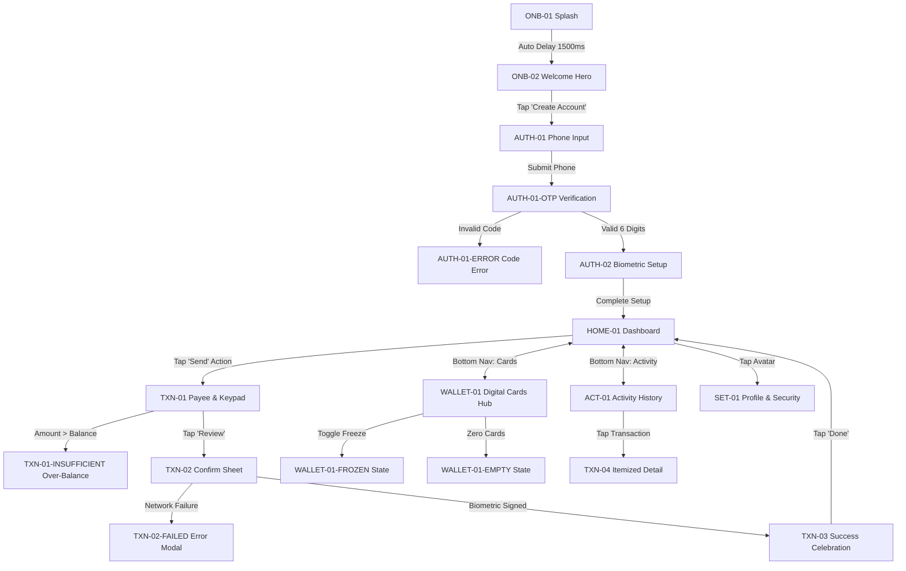

# Screen Architecture & Navigation Specification: Fintech Mobile App (iOS + Android)

## 1. Executive Summary & Product Objective
`fintech-mobile-app` is a world-class, production-grade digital banking and payment management mobile application with full native design parity across iOS (Apple HIG, iPhone 16 Pro `393 × 852 pt`) and Android (Material Design 3 / Android 15 edge-to-edge, `412 × 915 dp`).

- **Visual Direction**: "Quiet Precision" (Tactile warm paper `#F6F4EF`, deep obsidian ink `#0F1115`, single electric citrine accent `#D9F26B`, hairline borders `#E4E0D6`).
- **Typography Scale**: Editorial *Instrument Serif* display paired with structural *Inter* and *Roboto* body typography. Numbers treated as primary graphic elements.
- **Ergonomics & Touch**: Strict 44×44 pt (iOS) and 48×48 dp (Android) touch targets across all interactive buttons, keypad cells, and navigation tabs.
- **Hardware Safe Areas**: iOS (top 59 pt Dynamic Island, bottom 34 pt Home Indicator); Android (top 40 dp camera punch-hole, bottom 24 dp gesture bar).

---

## 2. Complete Screen & State Inventory (20 Screens per Platform · 40 Screens Total)

| Screen ID | Screen Name | Flow / Journey | Viewport | Primary Purpose | Entry Point | Primary Action |
|---|---|---|---|---|---|---|
| `ONB-01` | Splash Screen | Onboarding | 393×852 / 412×915 | Luminous brand identity & ambient warm-up | App Launch | Auto-advance (1.5s delay) |
| `ONB-02` | Welcome & Hero | Onboarding | 393×852 / 412×915 | Value proposition & 3D card perspective | `ONB-01` | Tap "Create Account" |
| `AUTH-01` | Phone Number Input | Auth & Security | 393×852 / 412×915 | E.164 phone entry with focused state | `ONB-02` | Tap "Continue" |
| `AUTH-01-OTP` | 6-Digit OTP Code | Auth & Security | 393×852 / 412×915 | 6-digit verification code with countdown | `AUTH-01` | Input OTP code |
| `AUTH-01-ERROR` | OTP Error State | Auth & Security | 393×852 / 412×915 | Code verification failure feedback | `AUTH-01-OTP` | Tap "Resend code now" |
| `AUTH-02` | Biometric Security | Auth & Security | 393×852 / 412×915 | Face ID / BiometricPrompt enrollment | `AUTH-01-OTP` | Tap "Enable Biometrics" |
| `HOME-01` | Main Dashboard | Core Product | 393×852 / 412×915 | Multi-currency balance card & activity feed | `AUTH-02` | Tap "Send" or Card |
| `HOME-01-LOADING` | Dashboard Skeleton | Core Product | 393×852 / 412×915 | Pulse shimmer skeleton across feed & cards | Launch | Content load complete |
| `HOME-01-OFFLINE` | Offline Warning | Core Product | 393×852 / 412×915 | Disconnected banner & action locking | `HOME-01` | Reconnect network |
| `WALLET-01` | Digital Cards Hub | Cards & Assets | 393×852 / 412×915 | Debit card hub with quick controls | Bottom Nav | Tap Card controls |
| `WALLET-01-FROZEN` | Frozen Card State | Cards & Assets | 393×852 / 412×915 | Card frozen overlay and banner | `WALLET-01` | Tap "Unfreeze Card" |
| `WALLET-01-EMPTY` | Empty Cards View | Cards & Assets | 393×852 / 412×915 | Zero active cards empty state | `WALLET-01` | Tap "Order Card" |
| `ACT-01` | Full Activity List | History & Search | 393×852 / 412×915 | Filtered search & categorized transactions | Bottom Nav | Tap Transaction item |
| `SET-01` | Profile & Security | Settings | 393×852 / 412×915 | Security toggles, app lock, profile | Header Avatar | Tap Settings toggle |
| `TXN-01` | Payee & Keypad | Payment Flow | 393×852 / 412×915 | Recipient avatars & custom numeric keypad | `HOME-01` "Send" | Tap "Review Transfer" |
| `TXN-01-INSUFFICIENT` | Over-Balance Warning | Payment Flow | 393×852 / 412×915 | Insufficient balance warning & CTA lock | `TXN-01` | Adjust transfer amount |
| `TXN-02` | Transfer Confirm Modal | Payment Flow | 393×852 / 412×915 | Bottom sheet fee breakdown & Face ID | `TXN-01` | Biometric signature |
| `TXN-02-FAILED` | Transfer Error Modal | Payment Flow | 393×852 / 412×915 | Network timeout / payment declined modal | `TXN-02` | "Try Again" / "Top Up" |
| `TXN-03` | Success Receipt | Payment Flow | 393×852 / 412×915 | Checkmark celebration & digital receipt | `TXN-02` | Tap "Done" |
| `TXN-04` | Transaction Detail | History & Search | 393×852 / 412×915 | Itemized receipt with dispute actions | `ACT-01` | "Download Receipt" |

---

## 3. Comprehensive State & Edge Case Coverage

Every production screen defines explicit visual treatments for secondary and error states:

| State ID | Parent Screen | State Type | Visual & Ergonomic Treatment |
|---|---|---|---|
| `HOME-01-LOADING` | `HOME-01` | Loading | Pulse shimmer skeleton across multi-currency balance and 4 transaction items. |
| `HOME-01-OFFLINE` | `HOME-01` | Edge State | Warning amber banner at header, locks transfer CTA, shows last cached timestamp. |
| `WALLET-01-EMPTY` | `WALLET-01` | Empty State | "No active cards yet" with custom card outline and prominent "Request Virtual Card" CTA. |
| `WALLET-01-FROZEN` | `WALLET-01` | Edge State | Frosted card glass overlay with snowflake badge and quick unfreeze toggle. |
| `AUTH-01-ERROR` | `AUTH-01` | Error State | Red border highlight on OTP boxes, shake animation, and "Resend code in 45s" link. |
| `TXN-01-INSUFFICIENT` | `TXN-01` | Error State | Crimson over-balance indicator below amount, disables proceed CTA. |
| `TXN-02-FAILED` | `TXN-02` | Failure State | Network timeout dialog with distinct "Try Again" and "Top Up" options. |

---

## 4. Screen-to-Screen Navigation Matrix



---

## 5. Motion & Animation Specifications

Animation in `fintech-mobile-app` conveys tangible security, tactile depth, and responsive feedback.

| Animation ID | Source → Destination | Trigger | Duration | Easing / Physics | Visual Transition Behavior | Reduced-Motion Alternative |
|---|---|---|---|---|---|---|
| `MOT-01` | `ONB-01` → `ONB-02` | Delay 1500ms | 450ms | `cubic-bezier(0.16, 1, 0.3, 1)` | Brand logo morphs upward into header; hero graphic scales 0.92 → 1.0; typography fades in (+12px Y). | Simple cross-fade 200ms |
| `MOT-02` | `ONB-02` → `AUTH-01` | On Tap "Create Account" | 320ms | `ease-out` (Smart Animate) | Push transition from right; bottom CTA button morphs smoothly into phone input container. | Instant push without morph |
| `MOT-03` | `HOME-01` → `TXN-01` | On Tap "Send" | 300ms | Spring `(mass: 1, stiffness: 220, damping: 24)` | Payee drawer slides up from bottom; background dashboard blurs (8px glass blur) and dims to 40% opacity. | Standard modal slide without blur |
| `MOT-04` | `TXN-02` → `TXN-03` | Biometric Signature | 550ms | `cubic-bezier(0.34, 1.56, 0.64, 1)` | Progress ring completes; morphs into elastic citrine checkmark plate; subtle celebratory particle burst. | Static checkmark + 150ms fade |

---

## 6. Proposed Figma Canvas Layout (8-Page Blueprint)

```text
Figma File: gtamCkSGXtOpzj3XYcWzie (Page 1 "0:1")
├── 00 Cover & Project Overview       # Title, metadata, platform targets (iOS & Android)
├── 01 Visual Research & References   # Benchmark boards: Revolut, Wise, Monzo, N26
├── 02 User Flows & Architecture      # Screen inventory, Mermaid flow diagrams, connection matrix
├── 03 Design Exploration            # Quiet Precision visual studies, typography ramps
├── 04 Approved UI Screens           # 40 native screens (6 boards: 8:2, 8:448, 8:1414, 8:2054, 8:2486, 8:3464)
├── 05 Components & Design System    # Cards, Keypads, Status bars, Buttons, Inputs
├── 06 Prototype & Interaction       # Smart animate connections & transitions
└── 07 Ready for Development         # Token handoff specs, SwiftUI / Compose parameters
```

---

## 7. Live Figma Canvas Nodes (File: gtamCkSGXtOpzj3XYcWzie)

The complete application is realized as native editable Figma frames on **Page 1 (`0:1`)**:
- **Board 03 (`8:2`)**: iOS Onboarding & Authentication (6 Screens: `8:7`, `8:32`, `8:93`, `8:180`, `8:283`, `8:391`)
- **Board 04 (`8:448`)**: iOS Home, Cards & Account (8 Screens: `8:453`, `8:607`, `8:696`, `8:839`, `8:947`, `8:1089`, `8:1155`, `8:1281`)
- **Board 05 (`8:1414`)**: iOS Payments (6 Screens: `8:1419`, `8:1560`, `8:1710`, `8:1814`, `8:1928`, `8:1973`)
- **Board 06 (`8:2054`)**: Android Onboarding & Authentication (6 Screens: `8:2059`, `8:2082`, `8:2141`, `8:2225`, `8:2325`, `8:2428`)
- **Board 07 (`8:2486`)**: Android Home, Cards & Account (8 Screens: `8:2491`, `8:2638`, `8:2725`, `8:2872`, `8:2984`, `8:3132`, `8:3198`, `8:3324`)
- **Board 08 (`8:3464`)**: Android Payments (6 Screens: `8:3469`, `8:3605`, `8:3750`, `8:3848`, `8:3959`, `8:4002`)
