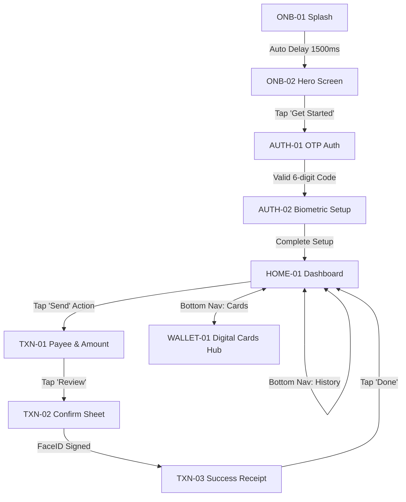

# Screen Architecture & Navigation Specification: Fintech Mobile App

## 1. Executive Summary & Product Objective
`fintech-mobile-app` is a premium, high-trust digital banking and wealth management mobile experience targeting modern iOS users (iPhone 16 Pro, `393 × 852 pt`).
- **Visual Theme**: 3D Claymorphism & Frosted Glass / Iridescent Metallic Accents.
- **Color Identity**: Electric Cobalt (`#007AFF`), Deep Iris (`#5856D6`), Cyber Gold (`#FF9500`), Pure Dark Surface (`#1C1C1E`).
- **Spatial System**: Strict 8pt grid with 16pt / 24pt container padding and 59pt top / 34pt bottom hardware safe areas.

---

## 2. Complete Screen Inventory & Hierarchy

| Screen ID | Screen Name | Flow / Journey | Viewport | Primary Purpose | Entry Point | Primary Action |
|---|---|---|---|---|---|---|
| `ONB-01` | Splash / Brand Reveal | Onboarding | 393×852 | Luminous brand identity & ambient warm-up | App Launch | Auto-advance (1.5s delay) |
| `ONB-02` | Value Prop & Hero | Onboarding | 393×852 | Value proposition featuring approved Hero visual | `ONB-01` | Tap "Create Account" |
| `AUTH-01` | Phone & SMS OTP | Auth & Security | 393×852 | E.164 phone input with inline 6-digit OTP boxes | `ONB-02` | Enter valid OTP code |
| `AUTH-02` | Biometric Security | Auth & Security | 393×852 | FaceID / TouchID activation with fallback passcode | `AUTH-01` | Tap "Enable FaceID" |
| `HOME-01` | Main Dashboard | Core Product | 393×852 | Multi-currency balance card, quick actions, feed | `AUTH-02` | Tap "Send" or Card |
| `WALLET-01`| Digital Cards Hub | Cards & Assets | 393×852 | 3D virtual debit card carousel, freeze & limit toggles | Tab Bar [Cards] | Tap Card to flip/manage |
| `TXN-01` | Payee & Amount Input | Payment Flow | 393×852 | Recent payees avatar list, currency toggle, keypad | `HOME-01` ["Send"] | Tap "Review Transfer" |
| `TXN-02` | Transfer Confirm Modal| Payment Flow | 393×852 | Bottom sheet fee breakdown, exchange rate & FaceID | `TXN-01` | Double-click / FaceID sign |
| `TXN-03` | Success Receipt | Payment Flow | 393×852 | Dynamic checkmark draw, transaction ID & receipt | `TXN-02` | Tap "Done" (→ `HOME-01`) |

---

## 3. Comprehensive State & Edge Case Coverage

Every production screen must define explicit visual treatments for secondary and error states:

| State ID | Parent Screen | State Type | Visual & Ergonomic Treatment |
|---|---|---|---|
| `HOME-01-LOADING` | `HOME-01` | Loading | Pulse shimmer skeleton across multi-currency balance and 4 transaction items. |
| `WALLET-01-EMPTY` | `WALLET-01` | Empty State | "No active cards yet" with custom 3D card outline and prominent "Request Virtual Card" CTA. |
| `AUTH-01-ERROR` | `AUTH-01` | Error State | Red border highlight on OTP boxes, shake animation, and "Resend code in 45s" link. |
| `TXN-02-FAILED` | `TXN-02` | Failure State | Network timeout / insufficient balance banner with distinct "Try Another Card" action. |

---

## 4. Screen-to-Screen Navigation Matrix



---

## 5. Motion & Animation Specifications

Animation in `fintech-mobile-app` conveys tangible security and responsive feedback.

| Animation ID | Source → Destination | Trigger | Duration | Easing / Physics | Visual Transition Behavior | Reduced-Motion Alternative |
|---|---|---|---|---|---|---|
| `MOT-01` | `ONB-01` → `ONB-02` | Delay 1500ms | 450ms | `cubic-bezier(0.16, 1, 0.3, 1)` | Brand logo morphs upward into header; hero graphic scales 0.92 → 1.0; typography fades in (+12px Y). | Simple cross-fade 200ms |
| `MOT-02` | `ONB-02` → `AUTH-01` | On Tap "Get Started" | 320ms | `ease-out` (Smart Animate) | Push transition from right; bottom CTA button morphs smoothly into phone input container. | Instant push without morph |
| `MOT-03` | `HOME-01` → `TXN-01` | On Tap "Send" | 300ms | Spring `(mass: 1, stiffness: 220, damping: 24)` | Payee drawer slides up from bottom; background dashboard blurs (8px glass blur) and dims to 40% opacity. | Standard modal slide without blur |
| `MOT-04` | `TXN-02` → `TXN-03` | FaceID Signature | 550ms | `cubic-bezier(0.34, 1.56, 0.64, 1)` | Progress ring completes; morphs into elastic green checkmark; subtle celebratory particle burst. | Static checkmark + 150ms fade |

---

## 6. Proposed Figma Canvas Layout (8-Page Blueprint)

```text
Figma File: gtamCkSGXtOpzj3XYcWzie
├── 00 Cover & Project Overview       # Title, version, device target (iPhone 16 Pro)
├── 01 Visual Research & References   # Benchmark boards: Revolut, Apple Wallet, Linear
├── 02 User Flows & Architecture      # Screen inventory, Mermaid flow diagrams, connection audit
├── 03 Design Exploration            # Frosted glass depth studies, typography ramps
├── 04 Approved UI Screens           # Production frames arranged in strict logical reading order:
│   ├── [SECTION: ONBOARDING]        # ONB-01, ONB-02
│   ├── [SECTION: AUTH & SECURITY]   # AUTH-01, AUTH-02
│   ├── [SECTION: CORE DASHBOARD]    # HOME-01, HOME-01-LOADING
│   ├── [SECTION: WALLET & CARDS]    # WALLET-01, WALLET-01-EMPTY
│   └── [SECTION: PAYMENTS]          # TXN-01, TXN-02, TXN-03
├── 05 Components & Design System     # Buttons, Cards, Inputs, List Items with Variant Sets
├── 06 Prototype & Interaction Studies# Connected click-through flows with Smart Animate
└── 07 Ready for Development         # Token export specs, spacing annotations, asset slice manifest
```

---

## 7. Quality & Connection Audit
- **Total Primary Screens**: 9
- **Total Documented Edge States**: 4
- **Dangling / Dead-end Screens**: 0 (All screens have defined exit, back, or completion paths)
- **Minimum Interactive Touch Target**: 44 × 44 pt
- **Auto Layout Compliance**: 100% (No arbitrary groups or fixed canvas coordinates)
