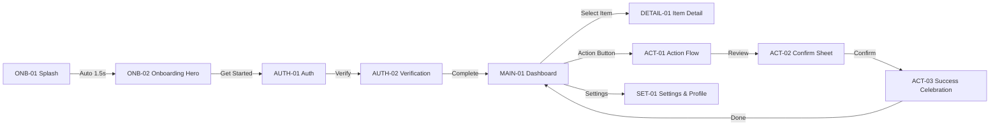

# Screen Architecture & Navigation Specification

## 1. Screen Inventory & Hierarchy

| Screen ID   | Screen Name           | Module / Flow   | Viewport          | Primary Purpose                                | Entry Point | Primary Action           |
| ----------- | --------------------- | --------------- | ----------------- | ---------------------------------------------- | ----------- | ------------------------ |
| `ONB-01`    | Splash / Brand Reveal | Onboarding      | Standard Viewport | Initial brand presentation & app loading       | App Launch  | Auto-advance (1.5s)      |
| `ONB-02`    | Value Prop & Hero     | Onboarding      | Standard Viewport | Introduce core benefits with hero visual       | `ONB-01`    | Tap "Get Started"        |
| `AUTH-01`   | Sign In / Register    | Authentication  | Standard Viewport | User identification & credential entry         | `ONB-02`    | Submit Credentials       |
| `AUTH-02`   | Verification / MFA    | Authentication  | Standard Viewport | Account verification or multi-factor code      | `AUTH-01`   | Confirm Verification     |
| `MAIN-01`   | Primary Dashboard     | Core Experience | Standard Viewport | Main application hub, overview, and navigation | `AUTH-02`   | Select action/item       |
| `DETAIL-01` | Item Detail View      | Core Experience | Standard Viewport | Deep item inspection & contextual actions      | `MAIN-01`   | Edit / Secondary action  |
| `ACT-01`    | Primary Action Flow   | Key Workflow    | Standard Viewport | Action parameters and form inputs              | `MAIN-01`   | Tap "Review & Confirm"   |
| `ACT-02`    | Confirmation Review   | Key Workflow    | Standard Viewport | Summary breakdown and authorization            | `ACT-01`    | Confirm Action           |
| `ACT-03`    | Success Celebration   | Key Workflow    | Standard Viewport | Completion receipt & next action prompts       | `ACT-02`    | Tap "Done" (→ `MAIN-01`) |
| `SET-01`    | Settings & Profile    | Account         | Standard Viewport | User profile, preferences, and system options  | `MAIN-01`   | Update preferences       |

---

## 2. Edge States & Secondary Views

| State ID          | Parent Screen | State Type    | Purpose & Handling                                                             |
| ----------------- | ------------- | ------------- | ------------------------------------------------------------------------------ |
| `MAIN-01-LOADING` | `MAIN-01`     | Loading       | Pulse shimmer skeleton across content cards and list items                     |
| `MAIN-01-EMPTY`   | `MAIN-01`     | Empty State   | Zero-data empty state with custom illustration and primary CTA                 |
| `AUTH-01-ERROR`   | `AUTH-01`     | Error State   | Input validation failure with red highlight, helper text, and retry CTA        |
| `ACT-02-FAILED`   | `ACT-02`      | Failure State | Action failure dialog with clear error explanation and retry / fallback action |

---

## 3. Navigation & Screen Connection Matrix

---

## 4. Motion & Animation Specifications

| Animation ID | Source Screen | Destination | Trigger              | Duration | Easing Curve                                    | Motion Behavior                                   | Reduced-Motion Fallback   |
| ------------ | ------------- | ----------- | -------------------- | -------- | ----------------------------------------------- | ------------------------------------------------- | ------------------------- |
| `MOT-01`     | `ONB-01`      | `ONB-02`    | Delay (1500ms)       | 450ms    | `cubic-bezier(0.16, 1, 0.3, 1)`                 | Hero graphic scales 0.95 → 1.0; text fades in     | Simple opacity fade 200ms |
| `MOT-02`     | `ONB-02`      | `AUTH-01`   | On Tap "Get Started" | 350ms    | `ease-out` (Smart Animate)                      | Push Left; action button morphs into input field  | Cross-fade 200ms          |
| `MOT-03`     | `MAIN-01`     | `ACT-01`    | On Tap Action        | 300ms    | Spring `(mass: 1, stiffness: 200, damping: 25)` | Modal sheet slides up with background dimming 40% | Instant sheet appearance  |
| `MOT-04`     | `ACT-02`      | `ACT-03`    | Confirm Action       | 450ms    | `cubic-bezier(0.34, 1.56, 0.64, 1)`             | Success checkmark draws; subtle micro-celebration | Static checkmark + fade   |

---

## 5. Proposed Figma Canvas Layout (8-Page Architecture)

1. `00 Cover & Project Overview`: Project title, device targets, design system specs.
2. `01 Visual Research & References`: Benchmarks, moodboard, color palette.
3. `02 User Flows & Navigation Architecture`: Mermaid diagrams, connection map, screen inventory.
4. `03 Design Exploration`: Typography tests, alternative card treatments, exploratory iterations.
5. `04 Approved UI Screens`: Production frames arranged left-to-right (`ONB` → `AUTH` → `MAIN` → `ACT`).
6. `05 Components & Design System`: Master buttons, inputs, cards, list items with variant sets.
7. `06 Prototype & Interaction Studies`: Clickable prototype connections, Smart Animate flows.
8. `07 Ready for Development`: Dev Mode redlines, tokens JSON, asset export specifications.
